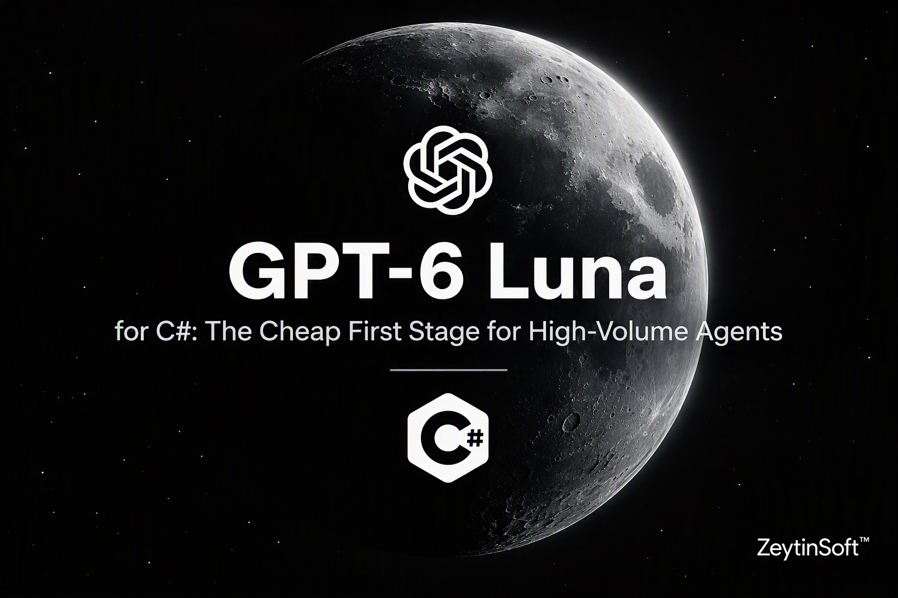

# GPT-6 Luna for C# Developers

> A runnable .NET 10 console app that uses **GPT-6 Luna** in **Microsoft Foundry** as the cheap first stage of a high-volume agent: it triages 100 support tickets, measures accuracy, missed escalations, latency and cost, and hands only the hard tickets to a bigger model.


[](https://github.com/taswar/GPT-6-Luna-Csharp-Sample/actions/workflows/dotnet.yml)

[](LICENSE)
[](CONTRIBUTING.md)

- 📖 Full walkthrough: [GPT-6 Luna for C# Developers](https://taswar.zeytinsoft.com/gpt-6-luna-csharp-developers-guide/?utm_source=github&utm_medium=readme&utm_campaign=GPT-6-Luna-Csharp-Sample&utm_content=walkthrough)
- ⭐ If this sample helps you, star the repo so other .NET developers can find it.
- 🔁 Related: [GPT-6.1 Terra C# Sample](https://github.com/taswar/GPT-6-1-Terra-CSharp-Sample), whose invoice agent Example 2 reuses unchanged
- For more C# samples using other AI models, see [AI models for C# developers](https://taswar.zeytinsoft.com/foundry-ai-models-csharp/?utm_source=github&utm_medium=readme&utm_campaign=GPT-6-Luna-Csharp-Sample&utm_content=ai-models-hub)
- For my free ebook on prompt engineering, see [Prompt Engineering for .NET Developers](https://github.com/taswar/PromptEngineeringForDotNetDevelopers)

It's one `Program.cs` that posts JSON to `/openai/v1/responses` with `HttpClient`, with no SDK wrapper in between, so you can see exactly what goes over the wire. Every example scores itself against labeled data and prints its token usage and an estimated cost, so you can decide with numbers whether Luna is good enough for your first stage.

## What's inside

| # | Example | What it shows |
|---|---------|---------------|
| 1 | **Triage support tickets** | Classifies the tickets in `tickets.json` with a strict JSON schema, using `triage-policy.md` as a cached prompt prefix. Prints precision, recall and F1 per category, accuracy, missed escalations, p50 and p95 latency, cache hits, and the cost per 1,000 tickets. |
| 2 | **Invoice agent on Luna vs. a bigger model** | Runs the GPT-6.1 Terra invoice agent, unchanged, on Luna and on the escalation model, from `invoice.pdf` and from `invoice.png`. Compares every extracted field side by side with the cost of each run. |
| 3 | **Triage, then escalate** | Luna triages everything. Only tickets the routing rule escalates go to the bigger model, which drafts a reply. Compares the cost with drafting every reply on the bigger model. |
| 4 | **Reasoning effort sweep** | Triages the same tickets at effort `none`, `low` and `medium`, and prints accuracy, missed escalations, reasoning tokens, cost and latency for each. |

Examples 2 and 3 need a second deployment in `AZURE_OPENAI_ESCALATION_DEPLOYMENT`. Without one, Example 2 runs on Luna only and Example 3 is skipped.

## Prerequisites

- **.NET 10 SDK**
- An Azure subscription with a **Microsoft Foundry** resource and a **GPT-6 Luna** deployment
- Optional: a bigger model on the same resource, such as **GPT-6.1 Terra**, for Examples 2 and 3
- One way to authenticate:
  - **Entra ID (recommended):** the **Azure CLI** signed in with `az login`, and the **Cognitive Services OpenAI User** role on the resource. The app uses `DefaultAzureCredential`.
  - **API key:** set `AZURE_OPENAI_API_KEY` and the app sends it instead of a token.

## Run it

**1. Clone the repo and store your settings** (user secrets are kept outside the repo):

```bash
git clone https://github.com/taswar/GPT-6-Luna-Csharp-Sample.git
cd GPT-6-Luna-Csharp-Sample
dotnet user-secrets set "AZURE_OPENAI_ENDPOINT" "https://<your-resource>.openai.azure.com"
dotnet user-secrets set "AZURE_OPENAI_DEPLOYMENT" "<your-luna-deployment>"
# Optional. A bigger model for Examples 2 and 3.
dotnet user-secrets set "AZURE_OPENAI_ESCALATION_DEPLOYMENT" "<your-terra-deployment>"
# Optional. Leave it out to sign in with Entra ID.
dotnet user-secrets set "AZURE_OPENAI_API_KEY" "<your-key>"
```

| Setting | Default | Purpose |
|---------|---------|---------|
| `AZURE_OPENAI_ENDPOINT` | (required) | The resource's base endpoint. The app appends `/openai/v1/responses` itself. |
| `AZURE_OPENAI_DEPLOYMENT` | `gpt-6-luna` | The Luna deployment |
| `AZURE_OPENAI_ESCALATION_DEPLOYMENT` | (none) | The bigger model for Examples 2 and 3 |
| `AZURE_OPENAI_REASONING_EFFORT` | `low` | Reasoning effort for Examples 1 to 3. Example 4 tries several values. |
| `AZURE_OPENAI_API_KEY` | (none) | Use an API key instead of Entra ID |

Environment variables with the same names work too, and override user secrets.

**2. Sign in and run** from the project folder, where the sample files are:

```bash
az login
dotnet run
```

**3. Run one example at a time,** and optionally limit the number of tickets:

```bash
dotnet run -- 1        # triage all 100 tickets
dotnet run -- 1 20     # triage the first 20
dotnet run -- 2        # invoice agent, PDF and PNG
dotnet run -- 3        # triage and escalate (20 tickets by default)
dotnet run -- 4        # effort sweep (20 tickets by default)
dotnet run -- all      # all four (the default)
```

## How it works

**The cached prefix.** Every triage request sends the same `triage-policy.md` as `instructions`, the same JSON schema and the same `prompt_cache_key`. Only the ticket changes. The first request runs alone so it writes the cache; the rest run four at a time and read it. Example 1 prints the usage of the first request and the others separately, so you can see the cached tokens.

**The routing rule lives in code.** Luna's own `needs_human` flag isn't the only signal. A ticket is escalated when any of these is true:

```csharp
triage.NeedsHuman
    || triage.Confidence == "low"
    || triage.Category == "data_loss"
    || triage.Priority == "p1";
```

A missed escalation, a ticket a person should have seen that Luna handled alone, is the costly mistake. That's why every example reports it next to accuracy.

**The labeled data.** `tickets.json` holds 100 fictional tickets for Contoso Sync Pro, each with an `expected_category` and `expected_escalate`. The expected answers are never sent to the model; they're only used for scoring. There are 7 categories, and 32 tickets should be escalated.

**Cost estimates.** `Prices` matches the deployment name against `luna`, `terra`, `sol` and `astra`, so name your deployments after the model. Prices are Global Standard short-context rates in USD per million tokens. Edit them for your region and agreement; the printed costs are estimates, not your bill.

## Good to know

- **Live calls cost money.** A full `dotnet run` makes roughly 160 or more model requests: 100 for Example 1, at least four for Example 2, 20 plus the drafts for Example 3, and up to 60 for Example 4. Use the ticket limit while you experiment.
- **The supplier lookup is simulated.** `check_supplier` in Example 2 is a hard-coded dictionary standing in for your ERP or vendor master. Nothing touches a real system.
- **Output varies.** Responses are model-generated and differ between runs. Compare accuracy and cost across several runs, not just one.
- **Responses aren't stored.** Triage and draft requests set `store: false`. The invoice agent stores them because it chains turns with `previous_response_id`.
- **Retries are built in.** `429` and `5xx` responses are retried up to five times, honoring `Retry-After`. Dropped connections are retried too, which is safe for read-only work like triage.
- **Timeouts.** The whole run shares one 30-minute budget, and each HTTP request has a 2-minute timeout.

## Troubleshooting

| Error | Likely cause | Fix |
|-------|--------------|-----|
| `InvalidOperationException: Set AZURE_OPENAI_ENDPOINT ...` | User secrets are missing | Run the `dotnet user-secrets set` commands from inside the project folder |
| `FileNotFoundException` for `tickets.json` or `triage-policy.md` | `dotnet run` was started from another folder | `cd` into the project folder, where the sample files are |
| `Responses API returned 404` | A deployment name doesn't match a deployment on the resource | Set the exact deployment name. A brand-new deployment can take about 5 minutes to become available. |
| `Responses API returned 401` / `403` | Missing role, wrong tenant, or a bad API key | Assign **Cognitive Services OpenAI User** and run `az login --tenant <id>`, or check `AZURE_OPENAI_API_KEY` |
| Many `[retry] 429` lines | The deployment's tokens-per-minute quota is low | Raise the quota, or run fewer tickets with `dotnet run -- 1 20` |
| `not accepted by this deployment` in Example 4 | The model doesn't support that reasoning effort | Expected. The sweep shows it and moves on. |
| No `Estimated cost` line | The deployment name doesn't contain `luna`, `terra`, `sol` or `astra` | Rename the deployment, or add your name to `Prices` |

## Dependencies

| Package | Version | Purpose |
|---------|---------|---------|
| `Azure.Identity` | 1.21.0 | `DefaultAzureCredential` for Entra ID sign-in |
| `Microsoft.Extensions.Configuration.UserSecrets` | 10.0.14 | Local development secrets |
| `Microsoft.Extensions.Configuration.EnvironmentVariables` | 10.0.14 | Settings from environment variables |

## Project layout

```
GPT-6-Luna-Csharp-Sample.csproj   Target framework, NuGet references, UserSecretsId
Program.cs                        All four examples, the routing rule, prices, ResponsesApi, Usage
triage-policy.md                  The triage policy, sent as the cached instructions
tickets.json                      100 labeled, fictional support tickets
invoice.pdf                       Invoice for Example 2
invoice.png                       The same invoice as an image
CONTRIBUTING.md                   How to contribute
LICENSE                           MIT license
.github/workflows/dotnet.yml      Build on every push and pull request
GPT-6-Luna-for-CSharp-*.png       Banner image for this README
```

## Learn more

- [GPT-6 Luna for C#: The Cheap First Stage for High-Volume Agents (blog post)](https://taswar.zeytinsoft.com/gpt-6-luna-csharp-developers-guide/?utm_source=github&utm_medium=readme&utm_campaign=GPT-6-Luna-Csharp-Sample&utm_content=walkthrough)
- [GPT-6.1 Terra for C# Developers (blog post)](https://taswar.zeytinsoft.com/gpt-6-1-terra-csharp-developers-guide/?utm_source=github&utm_medium=readme&utm_campaign=GPT-6-Luna-Csharp-Sample&utm_content=gpt-6-1-terra-csharp-developers-guide)
- [Azure OpenAI Responses API](https://learn.microsoft.com/azure/ai-foundry/openai/how-to/responses)
- [.NET Secret Manager](https://learn.microsoft.com/aspnet/core/security/app-secrets)

## License

MIT. See [LICENSE](LICENSE).

If this saved you time, a ⭐ helps other .NET developers find it.
